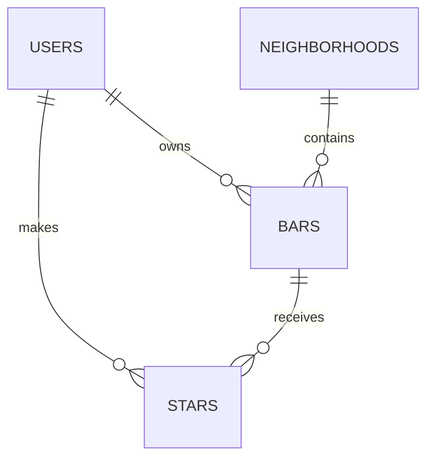

# PLAN.md — Bar Hop SF

## 1. Pitch

I'm building **Bar Hop SF**, a personal journal for San Francisco bars, because I want to remember where I've been, how I felt about each bar, and which ones I'd revisit. I'll use it about **twice a week**: after going out, to log a bar, and when deciding where to go next. Each person has a private account and their own journal.

## 2. Features (in build order)

**Spine**

1. **Sign up / login**: As a new visitor, I want to create an account and log in and out, so that my bar list is private to me.
2. **Data model**: As a user, I want each bar tied to an SF neighborhood, so that I can see where my favorites cluster.
3. **Create / read / update / delete**: As a user, I want to add a bar, see my list, open a bar's detail page, edit it, and delete it (with an "are you sure?" prompt), so that my log stays accurate.
4. **Validation**: As a user, I want a friendly message if I leave name, neighborhood, type, or status blank, or if I mark a bar "visited" without a rating, so that I don't save half-finished entries.
5. **Stars**: As a user, I want to star my go-to bars and see them in a "Starred" view, so that my top picks are one tap away.
6. **Find things**: As a user, I want to search by name or notes, filter by neighborhood and type, and sort by newest, highest rated, or A–Z, so that I can find the right bar quickly.
7. **Dashboard**: As a user, I want a chart of my bars per neighborhood plus my total bars, average rating, and % I'd return to, so that I can see my bar habits at a glance.

**My 3 features**

8. **Want-to-try list**: As a user, I want to save bars I haven't been to yet in a separate list, and mark them "visited" later, so that I remember recommendations.
9. **"Good for" tags**: As a user, I want to tag bars as good for things like *outdoor seating, sunny, watching sports, big groups, food*, and filter by those tags, so that I can match a bar to the occasion.
10. **"Pick a bar for tonight"**: As a user, I want a button that randomly picks one of my visited bars rated 4+ (optionally in a chosen neighborhood), so that I can stop debating where to go.

## 3. Database

| Table | Column | Type | Notes |
|---|---|---|---|
| **users** | id | text (uuid) | Primary key, created by the auth system |
| | email | text | Unique |
| | created_at | date | |
| **neighborhoods** | id | number | Primary key |
| | name | text | Unique (Marina, Mission, North Beach, Russian Hill, …). Shared list, pre-filled. |
| **bars** | id | number | Primary key |
| | user_id | text | References users.id: who owns this bar entry |
| | neighborhood_id | number | References neighborhoods.id |
| | name | text | Required |
| | type | text | Required: Sports, Dive, Wine, Cocktail, Brewery, or Other |
| | visit_status | text | Required: `visited` or `want_to_try` |
| | rating | number | 1–5. Required only if visited. |
| | would_return | true/false | Required only if visited |
| | vibe | text | Optional (e.g., "Casual, lively") |
| | good_for | text (list) | Optional tags: outdoor seating, sunny, sports, big groups, food |
| | notes | text | Optional |
| | created_at | date | Used for "newest first" sort |
| **stars** | user_id | text | References users.id |
| | bar_id | number | References bars.id |
| | created_at | date | Primary key is (user_id, bar_id), so a bar can't be starred twice |

**Relationships**
- A user has many bars (one-to-many).
- A neighborhood has many bars (one-to-many).
- Users and bars are connected many-to-many through **stars**: one row = "this user starred this bar." One table for everyone.

## 4. Tests

1. **Data isolation**: **Given** User A has saved Howell's and User B is a separate account, **when** User B logs in and opens their bar list (or visits Howell's detail page URL directly), **then** User B sees an empty list and a "not found" page, never User A's bar.
2. **Dashboard average rating**: **Given** a user has 5 visited bars rated 4, 4, 5, 3, 5 and 1 want-to-try bar with no rating, **when** they open the dashboard, **then** the average rating shows **4.2** (want-to-try bars are left out of the average).

## 5. Technologies

- **Coding agent: Claude Code.** It can run git and GitHub commands itself, so the Issue → branch → PR loop is fast.
- **Framework: Next.js.** Widely used, so the agent knows it well, and it deploys to Vercel with no extra setup.
- **Database: Supabase (Postgres).** A real relational database with free hosting, and its row-level security enforces "users only see their own bars" at the database level.
- **Sign up / login: Supabase Auth (email + password).** Built into the same service as the database, so every account is automatically a row in the users table.
- **Hosting: Vercel.** Every merge to main redeploys automatically, so the live URL always matches main.
- **Charts: Recharts.** A simple React chart library, enough for one bar chart.
- **Tests: Vitest.** Lightweight test runner that works with Next.js.

## 6. Design

A warm, vintage SF bar-journal feel: deep burgundy, cream, and muted olive, with clean readable text, simple cards, and 1–5 star ratings.

Mobile-friendly pages: **Journal** (my bars), **Favorites** (starred bars), **Wishlist** (want-to-try), **Dashboard**, and **Add Bar**.

Inspiration: a personal notes app mixed with a city guide, rather than a public review site.

## 7. Risks and cuts

- **Least sure I can build:** the data isolation test. Proving User B can't see User A's data means setting up two test accounts and testing against the real database rules, not just the UI.
- **Cut first if short on time:** "Good for" tags (feature 9). They need their own filter logic and form input. The random pick (feature 10) can still work without them, filtering by neighborhood and rating only.
- **Not in scope for now:** a Map page. Placing bars on a map needs each bar's location, which means an outside geocoding or places API. That fits better in the team project (Assignment H), which is about connecting to outside services.

## 8. Plan vs. Reality

Added at the end of the project. Sections 1–7 above are the original plan, unchanged. (Sections 2, 3, and 7 were edited during the build in [#6](https://github.com/maryborden-mb/bar-hop-sf/pull/6) and [#28](https://github.com/maryborden-mb/bar-hop-sf/pull/28); those edits were undone so the original reads as written, and the changes are recorded here instead.)

Live app: https://bar-hop-sf.vercel.app

| Planned feature | Shipped / Changed / Cut | Status (Done/Backlogged) | Learning | What changed and why (one line) |
|---|---|---|---|---|
| 1. Sign up / login | Changed | Done | | Built as planned ([#4](https://github.com/maryborden-mb/bar-hop-sf/pull/4)); later turned off "Confirm email" in Supabase so the automated isolation test could create accounts, so real sign-ups also skip confirming now. |
| 2. Data model | Changed | Done | I was already tracking outdoor seating in my spreadsheet even though my plan left it out. It's something I actually care about when choosing a bar, so it made sense to add. | Added a `has_outdoor_seating` yes/no column, because my own bar spreadsheet tracked it for every bar, and took "outdoor seating" out of the tags; "users" is Supabase Auth's built-in table, not a separate one ([#6](https://github.com/maryborden-mb/bar-hop-sf/pull/6)). |
| 3. Create / read / update / delete | Shipped | Done | | Built as planned ([#8](https://github.com/maryborden-mb/bar-hop-sf/pull/8)); my 5 real bars were loaded from my spreadsheet with SQL (with typo fixes) rather than typed in. |
| 4. Validation | Changed | Done | | Also requires "Would you go back?" for visited bars (the database needed it), and the Add form stopped pre-selecting "Visited" so a blank status can actually happen ([#10](https://github.com/maryborden-mb/bar-hop-sf/pull/10)). |
| 5. Stars | Shipped | Done | | The "Starred" view is the **Favorites** page from section 6, and the favorite star is gold so it isn't confused with the 1–5 rating stars ([#12](https://github.com/maryborden-mb/bar-hop-sf/pull/12)). |
| 6. Find things | Shipped | Done | | Search, filters, and sort work as planned; filtering happens in app code after loading my bars instead of in the database query, since a personal journal is small ([#14](https://github.com/maryborden-mb/bar-hop-sf/pull/14)). |
| 7. Dashboard | Shipped | Done | | Chart, total bars, average rating, and % would return as planned; the chart bars use a lighter burgundy than the brand color to pass a chart color check ([#16](https://github.com/maryborden-mb/bar-hop-sf/pull/16)). |
| 8. Want-to-try list | Changed | Done | | Became the **Wishlist** page, and the Journal now shows only visited bars so the two lists are truly separate; "mark as visited" asks for a rating and would-return answer ([#18](https://github.com/maryborden-mb/bar-hop-sf/pull/18)). |
| 9. "Good for" tags | Changed | Done | I thought tags would be too complicated and planned to cut them if needed, but they were easier to build than I expected. | Not cut even though it was first on the cut list; down to 4 tags because outdoor seating became its own field in feature 2 ([#22](https://github.com/maryborden-mb/bar-hop-sf/pull/22)). |
| 10. "Pick a bar for tonight" | Shipped | Done | | Built as planned: random pick from visited bars rated 4+, optionally by neighborhood; a "good for" option was offered but left out ([#24](https://github.com/maryborden-mb/bar-hop-sf/pull/24)). |
| Test 1: data isolation | Changed | Done | | Runs against the real Supabase database with two throwaway accounts (`npm run test:isolation`); needed "Confirm email" off and a real email domain, because Supabase rejected `@example.com` ([#20](https://github.com/maryborden-mb/bar-hop-sf/pull/20)). |
| Test 2: dashboard average | Shipped | Done | | Automated exactly as written: ratings 4, 4, 5, 3, 5 plus one want-to-try bar average to 4.2 ([#16](https://github.com/maryborden-mb/bar-hop-sf/pull/16)). |
| Design (section 6) | Changed | Done | I went back and forth on the colors a few times: I started with burgundy, tried emerald green, and ended up liking the original burgundy better. | Went from cream, burgundy, and olive to bolder fonts, a gold art-deco fan wallpaper on burgundy, a dark burgundy header, and brass instead of olive, after trying emerald and palm-leaf versions ([#26](https://github.com/maryborden-mb/bar-hop-sf/pull/26)). |
| Map page (section 7: not in scope) | Changed (added) | Done | I left the map out because I thought it would be too complicated, but a simpler version was actually pretty manageable. | Added a hand-drawn style neighborhood map that links to the filtered Journal; it needs no geocoding, so the reason it was out of scope didn't apply ([#28](https://github.com/maryborden-mb/bar-hop-sf/pull/28)). Placing individual bars on a real map is still backlogged for the team project. |
| Hosting on Vercel (section 5) | Shipped | Done | | Deployed at https://bar-hop-sf.vercel.app; every merge to `main` redeploys automatically ([#30](https://github.com/maryborden-mb/bar-hop-sf/pull/30)). |
