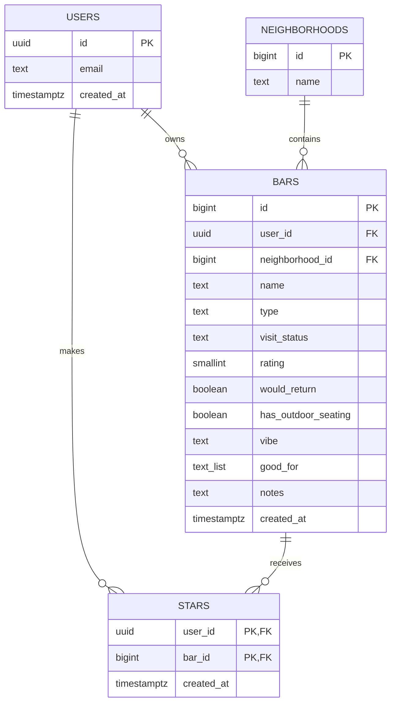

# schema.md — Bar Hop SF database

The database is Supabase (Postgres). It has **4 tables**: `users`, `neighborhoods`, `bars`, and `stars`. The SQL that created them is [`supabase/migrations/20261104000000_data_model.sql`](supabase/migrations/20261104000000_data_model.sql).

## How the tables connect

In plain English:

- **A user has many bars** (one-to-many). Every bar belongs to exactly one user.
- **A neighborhood has many bars** (one-to-many). Every bar is in exactly one neighborhood.
- **Users and bars are connected many-to-many through `stars`.** One row means "this user starred this bar." There's one `stars` table for everyone, not one per user.

## Tables

### `users`

Supabase Auth's built-in table (`auth.users`). Signing up in the app creates a row here automatically, so the app doesn't have its own users table. The app uses three of its columns:

| Column | Type | Notes |
|---|---|---|
| `id` | uuid | **Primary key.** Created by Supabase Auth |
| `email` | text | Unique. What you log in with |
| `created_at` | timestamp | When the account was made |

Passwords are stored by Supabase Auth (hashed), never by the app.

### `neighborhoods`

A shared list of San Francisco neighborhoods, the same for everyone. Pre-filled with 32 rows (Bayview through Union Square, plus "Other").

| Column | Type | Notes |
|---|---|---|
| `id` | number (bigint) | **Primary key**, numbered automatically |
| `name` | text | Required, unique |

### `bars`

The main table: one row per bar in someone's journal or wishlist.

| Column | Type | Notes |
|---|---|---|
| `id` | number (bigint) | **Primary key**, numbered automatically |
| `user_id` | uuid | Required. **Links to `users.id`**: who owns this bar. Deleting a user deletes their bars |
| `neighborhood_id` | number (bigint) | Required. **Links to `neighborhoods.id`** |
| `name` | text | Required, can't be blank |
| `type` | text | Required: `Sports`, `Dive`, `Wine`, `Cocktail`, `Brewery`, or `Other` |
| `visit_status` | text | Required: `visited` (shows in the Journal) or `want_to_try` (shows in the Wishlist) |
| `rating` | number (smallint) | 1–5. Required if visited |
| `would_return` | true/false | Required if visited |
| `has_outdoor_seating` | true/false | Required, defaults to false |
| `vibe` | text | Optional (e.g. "Casual, lively") |
| `good_for` | text list | Optional tags, only from: `sunny`, `sports`, `big groups`, `food`. Defaults to empty |
| `notes` | text | Optional |
| `created_at` | timestamp | Set automatically. Used for "newest first" |

The database itself enforces these rules, so a bar can't be saved without a name, with an unknown type, with a rating of 6, or as "visited" without a rating and a would-return answer. The app's friendly validation messages (feature 4) catch these first.

### `stars`

The junction table connecting users and bars.

| Column | Type | Notes |
|---|---|---|
| `user_id` | uuid | **Links to `users.id`**: who starred it |
| `bar_id` | number (bigint) | **Links to `bars.id`**: which bar. Deleting a bar deletes its stars |
| `created_at` | timestamp | Set automatically |

**Primary key:** (`user_id`, `bar_id`) together, so the same user can't star the same bar twice.

## Privacy: who can see what

Every table has row-level security turned on, so the database itself decides what each person can see, not just the app:

- **`bars`:** logged-in users can only read, add, edit, and delete their **own** bars.
- **`stars`:** logged-in users can only see and remove their own stars, and can only star their own bars.
- **`neighborhoods`:** anyone can read the list. Nobody can change it from the app.
- **Logged-out visitors** can't read bars or stars at all.

`npm run test:isolation` checks this against the real database with two separate accounts (PLAN.md test 1).

## Compared with the plan (PLAN.md section 3)

**Did the agent build what I designed?** Yes. The same 4 tables, the same relationships (two one-to-many and one many-to-many through `stars`), and the same primary keys, including `stars` keyed on (`user_id`, `bar_id`). The differences:

| Planned | Built | Why |
|---|---|---|
| A `users` table | Supabase Auth's built-in `auth.users` | The plan chose Supabase Auth, which keeps its own users table. Building a second one would have duplicated it |
| No outdoor seating column; "outdoor seating" was one of the `good_for` tags | A separate `has_outdoor_seating` true/false column, and `good_for` has 4 tags | My real bar spreadsheet tracked outdoor seating for every bar, so it became its own field (PR #6) |
| Types: text, number, date, true/false | More specific Postgres types: `uuid`, `bigint`, `smallint`, `timestamptz` | Same meaning, stricter storage (e.g. dates include the time) |
| Rules described in words ("1–5", "required only if visited") | The same rules enforced by the database (`check` constraints) | So bad data can't get in even if the app has a bug |
| (Not in the plan) | Row-level security rules on every table | PLAN.md section 5 said Supabase would enforce "users only see their own bars"; these rules are how |
